# Zerneas — Naruto survivors for Risk of Rain 2

 

Playable Naruto characters for Risk of Rain 2, with their Naruto Shippuden: Ultimate Ninja Storm 4 models, animations and voices, built to scale like vanilla survivors.

| Mod | What it is | Thunderstore |
|---|---|---|
| **KizunaMod** | Co-op bonds: each pair of these survivors shares a passive and a combined cinematic technique (key **C**). Required by the survivors below. | [Zerneas-KizunaMod](https://thunderstore.io/package/Zerneas/KizunaMod/) |
| **NarutoSageMod** | Sage Mode Naruto: natural energy, Frog Kumite, Big Ball Rasengan, Rasen-Shuriken, Six-Tails form. | [Zerneas-NarutoSageMod](https://thunderstore.io/package/Zerneas/NarutoSageMod/) |
| **SasukeMangekyouMod** | Taka Sasuke: Sharingan marks, Susanoo, Kusanagi, Chidori, Amaterasu, awakened Mangekyō form. | [Zerneas-SasukeMangekyouMod](https://thunderstore.io/package/Zerneas/SasukeMangekyouMod/) |
| **MinatoMod** | Minato, the Yellow Flash: Hiraishin kunai, seals, Rasengan, Senkō, Nine-Tails Chakra Mode. | [Zerneas-MinatoMod](https://thunderstore.io/package/Zerneas/MinatoMod/) |
| **NarutoShippudenMod** | Naruto: shadow clones that learn for him, Rasengan, Fuma Shuriken, Rasen-Shuriken, Four-Tails form. | [Zerneas-NarutoShippudenMod](https://thunderstore.io/package/Zerneas/NarutoShippudenMod/) |
| **SasukeShippudenMod** | Sasuke: fire heats the sky, lightning cashes it in: Kusanagi, Katon, Chidori, Kirin, Cursed Seal form. | [Zerneas-SasukeShippudenMod](https://thunderstore.io/package/Zerneas/SasukeShippudenMod/) |

## Install

Use [r2modman](https://thunderstore.io/package/ebkr/r2modman/) or the Thunderstore Mod Manager. The [**Naruto Collection**](https://thunderstore.io/c/riskofrain2/p/Zerneas/NarutoCollection/) modpack installs every character at once; or install the survivor you want: dependencies (including KizunaMod) come with it.

## In action

| | |
|:-:|:-:|
| 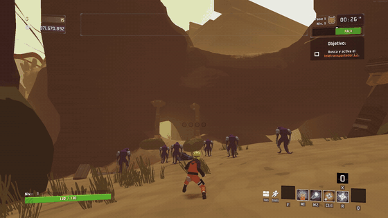 | 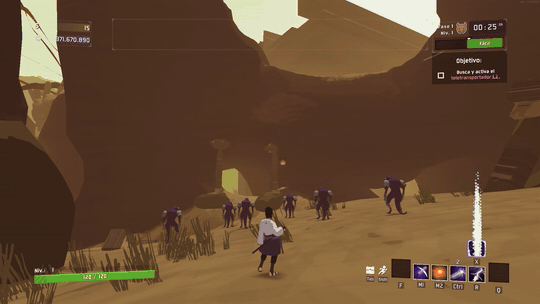 |
| 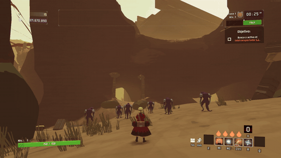 | 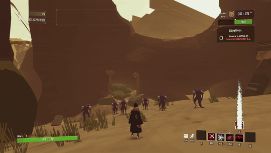 |
| 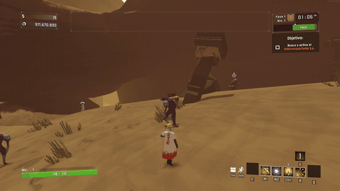 | 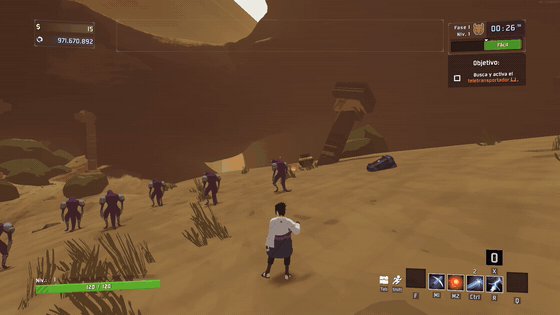 |
| 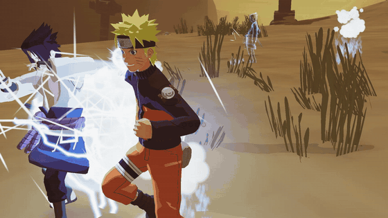 | 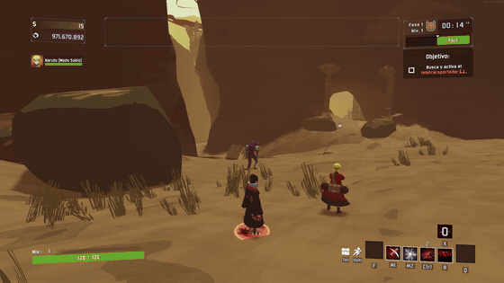 |

## Screenshots

| | |
|---|---|
| 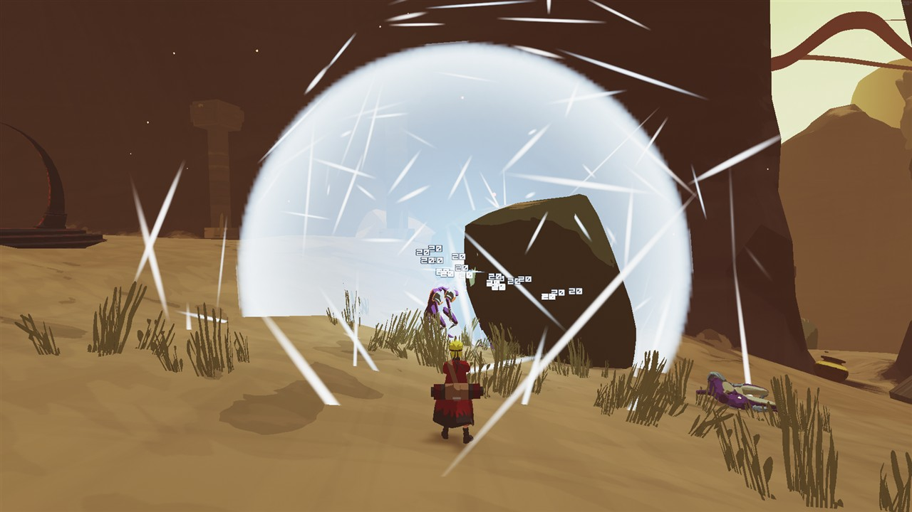 | 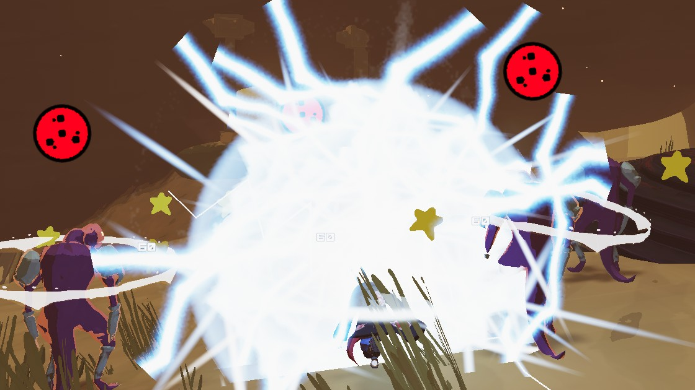 |
| 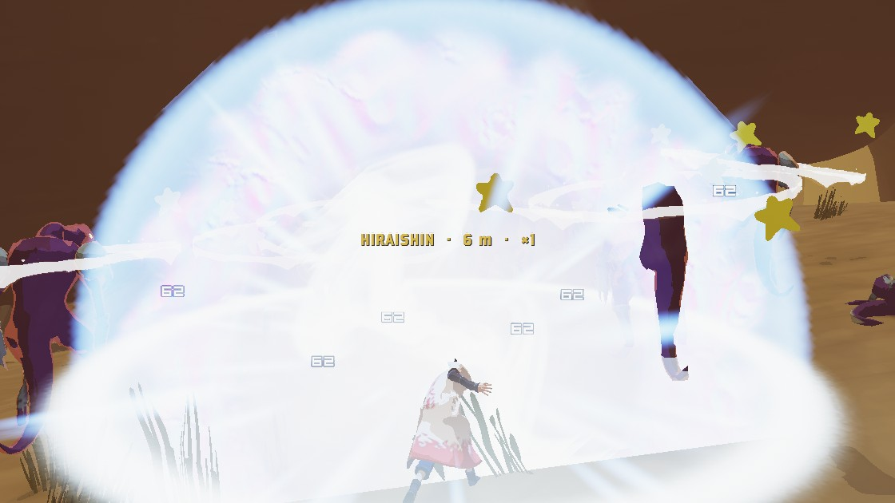 | 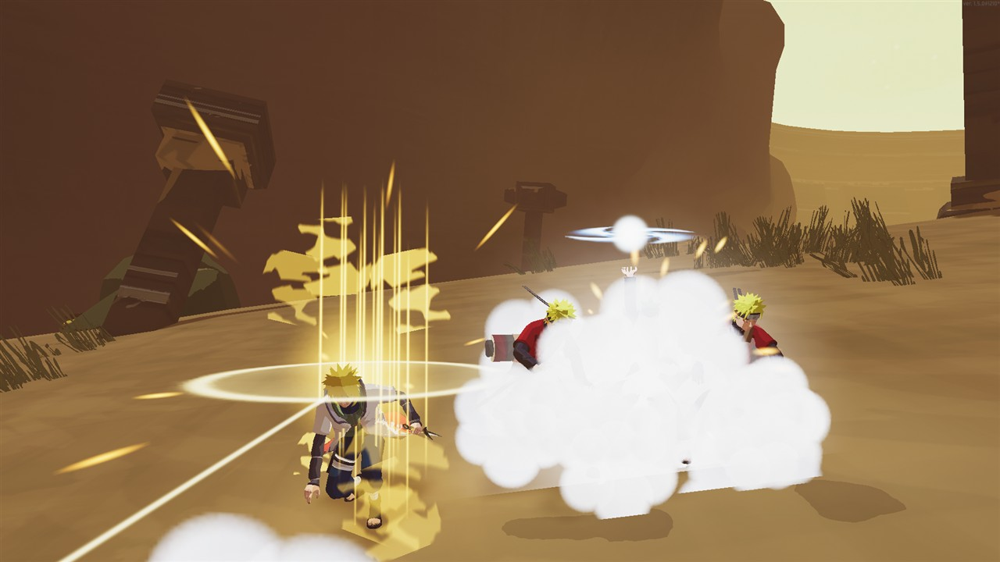 |
| 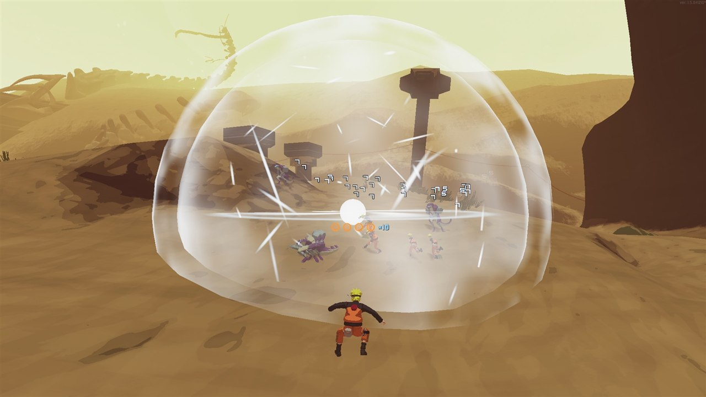 | 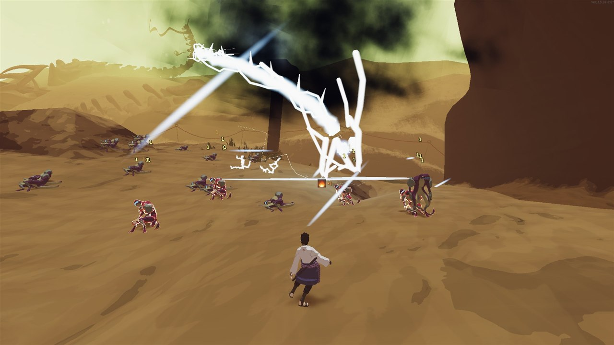 |

More in [`screenshots/`](screenshots/).

## Join the community

[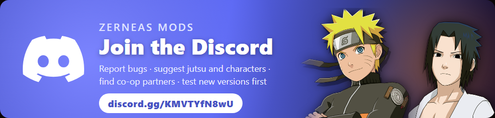](https://discord.gg/KMVTYfN8wU)

Bug reports, suggestions for jutsu and the next characters, co-op partners and early test versions: it all happens on the [Discord](https://discord.gg/KMVTYfN8wU).

## Bugs and suggestions

- **Bug?** Open an [issue](../../issues/new/choose) with the *Bug report* form. Attach your `LogOutput.log` (r2modman → Settings → Debugging → *Copy LogOutput contents to clipboard*, or `BepInEx/LogOutput.log` in your profile folder).
- **Idea or balance feedback?** Use the *Suggestion* form, or come to the Discord.
- **Discord:** https://discord.gg/KMVTYfN8wU

## Credits

Characters, models, animations and voices: *Naruto Shippuden: Ultimate Ninja Storm 4* (CyberConnect2 / Bandai Namco), based on Masashi Kishimoto's *Naruto*. This is a free fan project, not affiliated with or endorsed by them. Built on rob's Henry survivor template and the R2API team's libraries.
